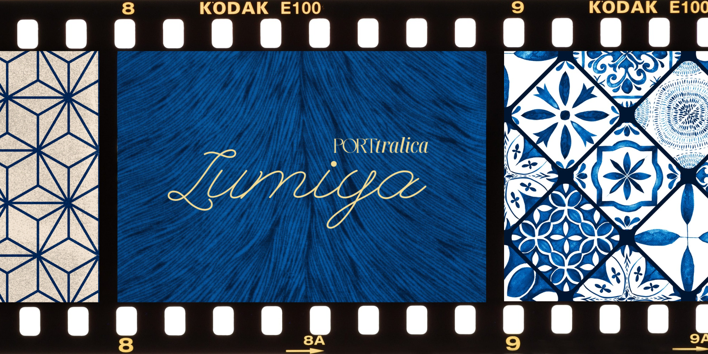

<p align="center">
  
</p>

# PORTtralica Lumiya

[](https://www.python.org/)
[](https://pytorch.org/)
[](#system-requirements)
[](LICENSE)

PORTtralica Lumiya is a stand-alone backend and WebUI deployment for hosting photo-defense algorithms targeting AI photo manipulation, style mimicry, data scraping; and forensic toolkit for Intellectual Property validation. Adapted to use open-sourced algorithms contributed by scientific researches and journals; steganographic watermark embedding, decoding, and analysing.

Everything executes locally on your machine.

---

## Important Disclaimer

PORTtralica Lumiya is an early evaluative pilot developed and maintained as a solo-developer research operation. It is not yet a complete commercial-grade product. Full algorithmic builds, exhaustive GPU kernel porting across every scientific paper, and plug-and-play coverage across all hardware configurations are actively evolving and are not to be expected out-of-the-box. Community participation and reproducible academic contributions to the `algos/` directory are welcome under the terms of the PolyForm Shield 1.0.0 license (see [CONTRIBUTING.md](CONTRIBUTING.md)).

---

## System Requirements

| Component | Minimum | Recommended |
|---|---|---|
| OS | Windows 10 / 11 (64-bit) | Windows 11 (64-bit) |
| Python | Python 3.10+ | Python 3.13 (via Miniconda3) |
| GPU | NVIDIA GPU with 4 GB VRAM (CUDA 12.6+) or CPU | NVIDIA RTX GPU with 6+ GB VRAM (CUDA 12.8+) |
| RAM | 8 GB System Memory | 16+ GB System Memory |
| Storage | 10 GB Free Storage Space | Fast NVMe SSD |

---

## Quick Start

### Option 1: One-Click Startup (Recommended)

1. Clone or download the repository to your local drive.
2. Launch `run.bat`:

   ```cmd
   run.bat
   ```
   *Lumiya runs automatic pre-flight verification on startup. If the environment or PyTorch packages are not yet provisioned, `run.bat` prompts you to launch `install.bat` automatically to detect your hardware, install the matched CUDA build (`cu132 / cu130 / cu128 / cu126`), set up all dependencies, and launch the WebUI.*

### Option 2: Direct Automated Installer

To run the automated dependency and environment installation upfront:
```cmd
install.bat
```

### Option 3: Manual Installation

If you prefer managing environments manually:

```bash
# 1. Create and activate environment
conda create -n lumiya python=3.13 -y
conda activate lumiya

# 2. Install PyTorch with CUDA 13.2 support
pip install torch torchvision --index-url https://download.pytorch.org/whl/cu132

# 3. Install dependencies
pip install -r requirements.txt

# 4. Launch server
python protect.py
```

---

## Installation Process and Manifest Log

`install.bat` sets up the project dependencies and writes a full log to `install_manifest.log` so you can verify everything that was installed.

### 1. Environment Check (`run.bat`)
When you launch `run.bat`, it checks your system before running:
* Confirms Git and Python are present.
* Looks for an existing Python environment in this order:
  1. Local `.env` folder inside the project.
  2. Conda installations (Miniconda / Anaconda).
  3. An existing `lumiya` Conda environment.
* If required packages (`torch`, `diffusers`, `Pillow`) are missing, it asks how to proceed:
  - Press `I` to run `install.bat`.
  - Press `W` to start in limited mode using your base Python.
  - Press `Q` to exit.

### 2. What `install.bat` Does
When `install.bat` runs, it:
1. Verifies that Git and Conda are installed.
2. Checks for an NVIDIA graphics card and reads your driver's CUDA version using `nvidia-smi`.
3. Creates an isolated Conda environment named `lumiya` (Python 3.13) so your global setup is untouched.
4. Installs the matching PyTorch build for your GPU (`cu132`, `cu130`, `cu128`, or `cu126`). If no NVIDIA GPU is detected or your driver supports less than CUDA 12.6, it installs the CPU build.
5. Installs required libraries: `diffusers`, `transformers`, `accelerate`, `safetensors`, `Pillow`, `psutil`, and `numpy`.
6. Clears pip and Conda cache files to save disk space.

### 3. What is in `install_manifest.log`
Each time the installer runs, it writes `install_manifest.log` to document:
* System info: Date, time, Windows username, and Conda path.
* Hardware detected: GPU model and the chosen PyTorch build.
* Package list:
  - `[KEPT]`: Packages already present.
  - `[NEW]`: Packages added by the installer with their exact version numbers.
* Verification check: Tests importing each library and logs their versions to confirm they load without errors.

---

## Active Algorithms and Scientific References

All algorithms implemented in the `algos/` directory are sourced from peer-reviewed scientific literature and established preprints:

1. PhotoGuard (Encoder Attack)
   - Paper: Raising the Cost of Malicious AI: Impeding Image-to-Image Translation with Adversarial Attacks
   - Authors: Hadi Salman, Alaa Khaddaj, Guillaume Leclerc, Andrew Ilyas, Aleksander Madry (MIT CSAIL)
   - Venue: ICML 2023
   - Citation: [arXiv:2302.06588](https://arxiv.org/abs/2302.06588)
   - Threat Model: VAE latent disruption forcing image-to-image translations toward an arbitrary target or gray latent.

2. VETO
   - Paper: VETO: Latent Semantic & Cross-Attention Veto Defense for Diffusion Transformers
   - Authors: Jonas Grebe, Mohammadreza Shakibania, Jeanette Braun, Marcus Rohrbach, Anna Rohrbach (TU Darmstadt & hessian.AI)
   - Venue: arXiv 2026
   - Citation: [arXiv:2607.27292](https://arxiv.org/abs/2607.27292)
   - Threat Model: Bidirectional canvas-reference joint-attention entropy maximization in multi-modal Diffusion Transformers (MMDiT / FLUX / SD3).

3. DiffusionGuard
   - Paper: Contour-Based Mask Augmentation Inpainting Defense
   - Authors: William June Suk Choi et al.
   - Venue: ICLR 2025
   - Citation: [arXiv:2410.05694](https://arxiv.org/abs/2410.05694)
   - Threat Model: U-Net and posterior error maximization using contour-shrink mask augmentation against object removal and generative inpainting.

4. MetaCloak
   - Paper: MetaCloak: Preventing Unauthorized Fine-Tuning of Diffusion Models via Meta-Learning
   - Authors: Yixin Liu, Chenrui Fan, Yutong Dai, Xun Chen, Pan Zhou, Lichao Sun
   - Venue: CVPR 2024
   - Citation: [arXiv:2311.13127](https://arxiv.org/abs/2311.13127)
   - Threat Model: Meta-learning surrogate transformations crafting perturbations robust against image filtering and Gaussian blur during fine-tuning (DreamBooth/LoRA).

5. Mist v2 / AdvDM
   - Paper: Adversarial Example Defense Against Diffusion-Based Image Manipulation
   - Authors: Chumeng Liang, Xiaoyu Wu, Yang Hua, Jiaru Zhang, Yiming Xue, Tao Song, Haibing Guan
   - Venue: ICML 2023
   - Citation: [arXiv:2302.04578](https://arxiv.org/abs/2302.04578)
   - Threat Model: Directed gradient errors injected into latent representations causing unauthorized fine-tuning and style mimicry to collapse into chaotic textures.

6. BlurGuard
   - Paper: BlurGuard: Frequency-Naturalness Hardening Against Adversarial Purification
   - Authors: Jongheon Jeong et al. (Korea University / TAIL Lab)
   - Venue: arXiv 2025
   - Citation: [arXiv:2511.00143](https://arxiv.org/abs/2511.00143)
   - Threat Model: Differentiable Gaussian smoothing and quantization optimization to ensure perturbations survive spatial low-pass filtering and lossy JPEG compression.

7. AntiPure
   - Paper: Erroneous Timestep Guidance Against Diffusion Purifiers
   - Authors: Diffusion Purification Counter-Defense Research
   - Citation: [arXiv Search: Diffusion Purification Adversarial Defense](https://arxiv.org/search/?query=diffusion+purification+adversarial+defense+DiffPure&searchtype=all)
   - Threat Model: Exploiting diffusion purification schedules (DiffPure / Score-SDE) via erroneous timestep guidance so purifying pipelines embed adversarial noise deeper into latents.

8. IMPRESS
   - Paper: IMPRESS: Imperceptible High-Frequency Reconstruction Resilience Defense
   - Authors: Bochuan Cao, Changjiang Li, Ting Wang, Jinyuan Jia, Bo Li, Jinghui Chen
   - Venue: NeurIPS 2023
   - Citation: [arXiv:2310.19248](https://arxiv.org/abs/2310.19248)
   - Threat Model: Concentrating perturbation power into high-frequency structural bands that low-pass purification algorithms fail to strip.

9. Anti-Inpainting
   - Paper: 9-Channel Masked Boundary Context Poisoning
   - Authors: Spatial Occlusion & Boundary Conditioning Defense (PORTtralica Research Synthesis)
   - Citation: [arXiv:2302.06588](https://arxiv.org/abs/2302.06588)
   - Threat Model: Simulating stochastic brush masks during projected gradient descent to poison boundary contexts used by 9-channel inpainting models (SD-Inpaint / ControlNet).

10. Anti-I2V
    - Paper: Perceptual Opponent-Color & Spectral Image-to-Video Disruption
    - Authors: Image-to-Video Perceptual Defense Research
    - Citation: [arXiv Search: Image-to-Video Adversarial Defense](https://arxiv.org/search/?query=image+to+video+adversarial+defense+temporal+coherence&searchtype=all)
    - Threat Model: Disrupting temporal frame coherence in image-to-video generators (SVD, Kling, Runway Gen-3) via opponent-color and spectral frequency optimization.

11. ChronoLock
    - Paper: Temporal Denoising & Cross-Chunk Boundary Disruption
    - Authors: Long-Horizon Video Chunk Defense Architecture
    - Citation: [arXiv Search: Temporal Chunk Boundary Video Defense](https://arxiv.org/search/?query=temporal+chunk+boundary+adversarial+video+diffusion&searchtype=all)
    - Threat Model: Securing visual assets against text-to-video personalization by combining intra-chunk chaos and cross-chunk boundary disruption across sliding-window samplers.

12. DeContext & CaD
    - Paper: Context Detachment for Diffusion Transformers (DeContext & CaD)
    - Authors: Diffusion Transformer Context Detachment Architecture
    - Citation: [arXiv Search: DeContext Diffusion Transformer Defense](https://arxiv.org/search/?query=DeContext+Diffusion+Transformer+defense&searchtype=all)
    - Threat Model: Restricting optimization to early timesteps and context-heavy attention blocks in DiT architectures to detach input conditioning from generated output.

13. DiffVax
    - Paper: DiffVax: Nested Multi-Scale Skip-Connection Cloak
    - Authors: Multi-Scale Residual Skip-Connection Defense Architecture
    - Citation: [arXiv Search: DiffVax Adversarial Image Protection](https://arxiv.org/search/?query=DiffVax+adversarial+image+protection&searchtype=all)
    - Threat Model: Targeting U-Net and ResNet multi-scale skip-connection pooling to disrupt spatial edits and fine-grained video manipulation.

14. FastProtect & TC-UAP
    - Paper: Universal Adversarial Perturbation & Temporal-Consistent UAP Basis Defense
    - Authors: Universal Spatial & Temporal Basis Defense Architecture
    - Citation: [arXiv Search: Universal Adversarial Perturbation Diffusion Protection](https://arxiv.org/search/?query=Universal+Adversarial+Perturbation+Diffusion+Protection&searchtype=all)
    - Threat Model: Rapid pre-computed Universal Adversarial Perturbation basis vectors accelerating spatial and temporal protection with minimal GPU step budgets.

15. GenPTW & TAG-WM
    - Paper: Latent-Space Provenance Watermarking & Tamper Localization
    - Authors: Dual Latent Provenance & Tamper Localization Research
    - Citation: [arXiv Search: Latent Space Watermarking Tamper Localization](https://arxiv.org/search/?query=latent+space+watermarking+tamper+localization+diffusion&searchtype=all)
    - Threat Model: Embedding structured dual latent-space provenance watermarks that enable downstream tamper localization and ownership verification if images are modified.

16. IDProtector
    - Paper: Multi-Encoder Biometric Identity Inconsistency Defense
    - Authors: Biometric & Facial Identity Defense Architecture
    - Citation: [arXiv Search: IDProtector Facial Identity Defense](https://arxiv.org/search/?query=IDProtector+facial+identity+adversarial+diffusion&searchtype=all)
    - Threat Model: Inducing feature inconsistency across facial recognition backbones and biometric identity adapters (InstantID, IP-Adapter-FaceID, PhotoMaker).

17. MIRAGE
    - Paper: Policy & Moderation Classifier Alignment Defense
    - Authors: Anshul et al.
    - Citation: [arXiv Search: MIRAGE Adversarial Protection](https://arxiv.org/search/?query=MIRAGE+adversarial+image+protection&searchtype=all)
    - Threat Model: Aligning image representations with safety-classifier boundary anchors so commercial multimodal APIs (OpenAI GPT-4o, Google Gemini, xAI Grok) trigger refusal flags on automated edit requests.

18. Obliviate
    - Paper: KL-Supervised Visual Token Distribution Concept Erasure
    - Authors: Visual Token Distribution Concept Erasure Architecture
    - Citation: [arXiv Search: Obliviate Concept Erasure Visual Tokens](https://arxiv.org/search/?query=Obliviate+concept+erasure+visual+tokens&searchtype=all)
    - Threat Model: Erasing semantic concepts in autoregressive visual-language models and tokenized multimodal architectures via Kullback-Leibler divergence supervision over visual token distributions.

19. PromptFlare
    - Paper: Cross-Attention BOS Token Decoy Defense
    - Authors: Invariant Token Cross-Attention Decoy Architecture
    - Citation: [arXiv Search: PromptFlare Cross-Attention Defense](https://arxiv.org/search/?query=PromptFlare+cross+attention+adversarial+diffusion&searchtype=all)
    - Threat Model: Directing cross-attention weights away from text prompts and anchoring them onto invariant Beginning-of-Sequence (BOS) tokens to neutralize conditioning.

20. SRIM
    - Paper: Scale-Robust Image Immunization via Minimax Geometric Anchors
    - Authors: Scale-Robust Minimax Defense Architecture
    - Citation: [arXiv Search: Scale-Robust Diffusion Defense](https://arxiv.org/search/?query=scale+robust+image+protection+diffusion&searchtype=all)
    - Threat Model: Minimax optimization over continuous geometric scaling anchors (1.7x to 7.1x) ensuring protection survives web scraper downscaling and responsive cropping.

21. Vid-Freeze
    - Paper: Motion Dynamics Suppression via Target Attention Freezing Loss
    - Authors: Video Diffusion Motion Freezing Architecture
    - Citation: [arXiv Search: Video Diffusion Motion Freezing Defense](https://arxiv.org/search/?query=video+diffusion+adversarial+motion+freezing&searchtype=all)
    - Threat Model: Suppressing motion dynamic latent vectors so video generation pipelines collapse into static frame repetition.

---

## Key Capabilities (Expected)

> Note: The capabilities detailed below represent the architectural design and active development roadmap of the Lumiya pilot. Because algorithmic porting and hardware optimizations are actively being refined, full perfection and complete deployment across all defense combinations are in progress.

### Modular AI-Defense Layers (Expected)
Lumiya integrates 21 modular adversarial defense algorithms published across machine learning venues (ICML, ICLR, CVPR, NeurIPS, arXiv). Each layer targets distinct vulnerabilities in modern diffusion models, vision transformers, and multimodal encoders:

* Latent Encoder and VAE Disruptors: PhotoGuard, AntiPure, Mirage, MetaCloak, IMPRESS.
* Diffusion Transformers (DiT and MMDiT) Hooks: VETO, DeContext & CaD.
* Temporal and Video Diffusion Cloaks: Anti-I2V, ChronoLock, Vid-Freeze.
* Inpainting and Mask Augmentation: Anti-Inpainting, DiffusionGuard.
* Concept Erasure and Biometric Inconsistency: IDProtector, Obliviate, SRIM, PromptFlare, DiffVax, FastProtect & TC-UAP.
* Frequency and Purification Hardening: BlurGuard, GenPTW & TAG-WM.

### Dual Steganography and Visual Marker Engine (Expected)
* 2-Bit Cyclic LSB Framing: Embeds cryptographic copyright text and provenance signatures directly into uncompressed RGB bitplanes (`stego/lsb.py`).
* Resilient Visual Watermarking: Embeds quad-pattern bitplane markers designed to survive lossy social media recompression (JPEG quality degradation) and proportional downscaling (`stego/mark.py`).
* Stego Verifier: Decodes embedded signatures and bitplane markers in one click directly from the queue ribbon.

### Forensic Inspector (Expected)
* Multi-View Modes: Single image, Side-by-Side before/after, and interactive Split-Wipe slider.
* Synchronized Loupe: 1x to 16x pan-and-zoom inspection with sub-pixel alignment.
* Forensic Analysis Lenses: Real-time LSB bitplane viewer, Error Level Analysis (ELA), Fast Fourier Transform (FFT) frequency spectrum, and Sobel edge derivative masks.

### Batch Queue and Hardware Telemetry (Expected)
* Drag-and-Drop Batching: Queue multiple photo sets, reorder images, split batches, and adjust perturbation budgets and step counts.
* Hardware Monitor: Real-time NVML hardware telemetry displaying GPU load, VRAM allocation, GPU temperatures, and power draw.

---

## Repository Structure

```
lumiya/
|-- algos/                   # 21 Modular defense algorithm implementations
|   |-- photoguard/          # PhotoGuard ICML 2023 encoder attack
|   |-- veto/                # VETO cross-attention transformer cloak
|   |-- ...                  # Mirage, MetaCloak, DiffusionGuard, AntiPure, etc.
|-- stego/                   # Steganography and resilient visual marker engine
|   |-- lsb.py               # 2-bit cyclic LSB RGB channel embedding
|   |-- mark.py              # Visual watermark placement and recovery
|-- results/                 # Exported protected batches (git-ignored)
|-- cleaner.py               # VRAM purging and memory garbage collection
|-- config.json              # Shipped default suite configuration
|-- install.bat              # Automated environment and dependency installer
|-- run.bat                  # Production application launcher
|-- uninstall.bat            # Clean uninstaller for Conda environment
|-- protect.py               # Core HTTP server, engine coordinator, and worker
|-- requirements.txt         # Core dependencies
|-- ui.html                  # Single-file WebUI (Photoshop/Lightroom dark aesthetic)
|-- logo.png                 # Application logo for README.md
|-- CONTRIBUTING.md          # Scientific paper guidelines for algo contributions
|-- LICENSE                  # PolyForm Shield License 1.0.0
`-- README.md
```

---

## Configuration and Defaults

Lumiya ships with `config.json` containing default application and protection parameters. The core engine (`protect.py:SuiteConfig`) also contains hardcoded internal defaults, ensuring the suite can gracefully boot with clean settings even if `config.json` is missing.

Key configuration fields include:
* `epsilon`: Default perturbation budget (4.0/255).
* `steps`: Optimization iteration budget (50 steps).
* `precision`: Numerical precision (`fp16` or `fp32`).
* `reserveVramMb`: Safety margin reserved for OS and display rendering (600 MB).
* `jpegQuality`: Export compression quality (98).
* `overrideHardware`: Enforces hardware safety tiers (`false` by default).
* `favoriteAlgos`: Pinned algorithms in the WebUI.

---

## License and Community Contributions

PORTtralica Lumiya is licensed under the **PolyForm Shield License 1.0.0** (SPDX identifier: `PolyForm-Shield-1.0.0`). See the [LICENSE](LICENSE) file for the full legal text.

### Summary of Terms

* Commercial Projects Permitted: You are free to run, inspect, modify, and use Lumiya on commercial creative projects, commercial photography, client campaigns, editorial publications, and business visual assets without paying royalties or fees.
* Software Commercial Exploitation Prohibited: You may not sell, monetize, sub-license, or repackage Lumiya or its core engine as a commercial software product, nor operate it as a competing commercial hosted service (SaaS) or paid API.
* Open Community Contributions to Algorithms: Collaborative community contributions to the `algos/` directory are actively encouraged. As detailed in [CONTRIBUTING.md](CONTRIBUTING.md), all submitted defense algorithms must be directly sourced from peer-reviewed scientific literature or established preprints with academic citations and reproducible loss formulations.
