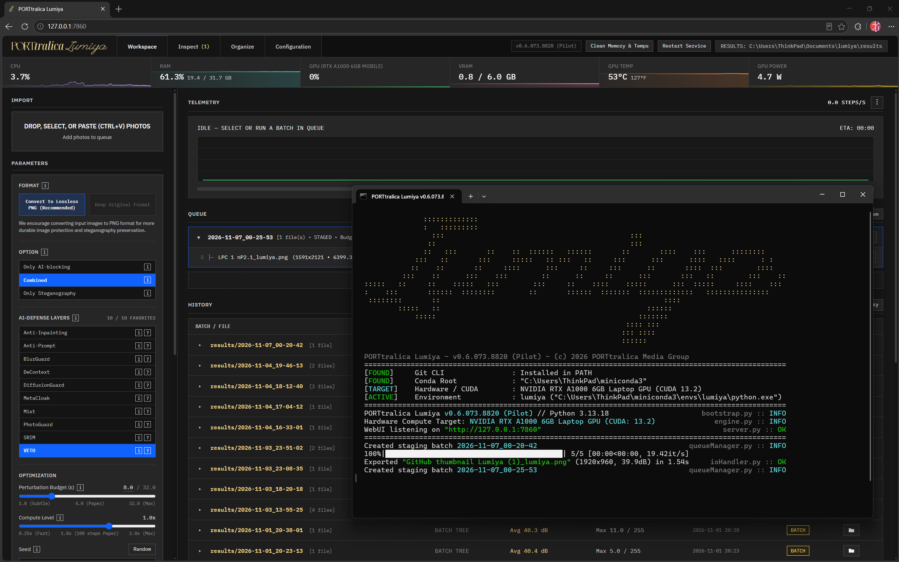
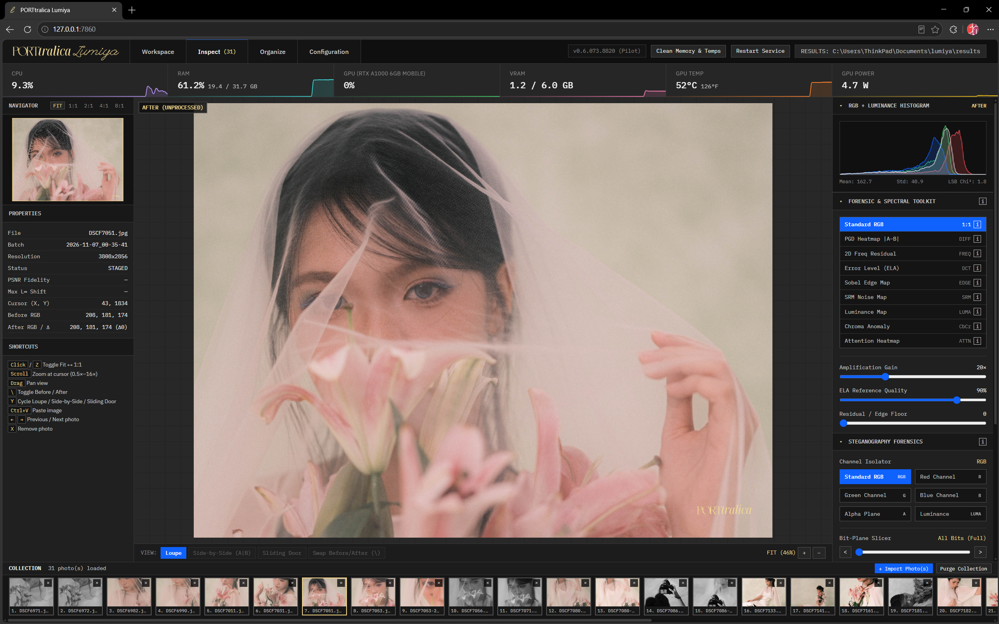
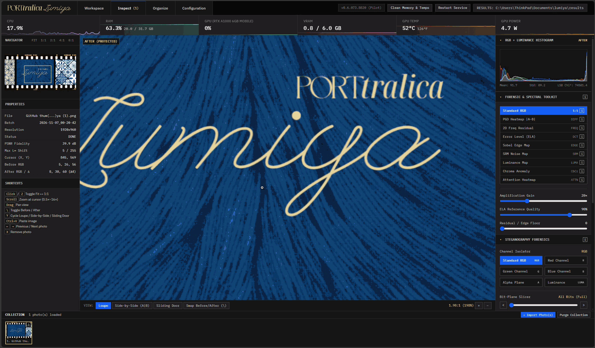

<p align="center">
  
</p>

# PORTtralica Lumiya

[-E5B869.svg)](#)
[](https://www.python.org/)
[](https://pytorch.org/)
[](#system-requirements)
[](LICENSE)

**PORTtralica Lumiya** is a local-first adversarial photo defense and steganographic forensic suite built to protect photography and visual artwork against unauthorized AI scraping, style mimicry, generative inpainting, and biometric identity cloning. It brings open-source defenses from peer-reviewed machine learning papers (`ICML`, `ICLR`, `CVPR`, `ICCV`, `NeurIPS`, `arXiv`) into a single self-hosted engine with a native-resolution darkroom inspector and multi-layer steganography.

Everything runs locally on your own hardware — no photos or telemetry ever leave your machine.

<p align="center">
  
</p>

---

## Important Disclaimer

PORTtralica Lumiya is an evaluative pilot developed and maintained as an independent research project. While core algorithms and steganographic pipelines are audited against their published paper specifications, several literature modules (marked with `▲`) remain in active development awaiting upstream author checkpoints or multi-GPU video pipelines. Reproducible academic contributions to `algos/` are welcome under the [PolyForm Shield 1.0.0 License](LICENSE) (see [CONTRIBUTING.md](CONTRIBUTING.md)).

---

## System Requirements

| Component | Minimum | Recommended |
| :--- | :--- | :--- |
| **Operating System** | Windows 10 / 11 (64-bit) or Linux (Debian/Ubuntu, Fedora/RHEL, Arch, openSUSE, WSL2) | Windows 11 (64-bit) or Ubuntu 22.04 / 24.04 LTS |
| **Python** | Python 3.10+ | Python 3.13 (via Miniconda3) |
| **GPU Acceleration** | NVIDIA GPU with 4 GB VRAM (CUDA 12.6+) or CPU fallback (with System RAM Spillover) | NVIDIA RTX GPU with 6+ GB VRAM (CUDA 12.8 – 13.2) |
| **System Memory** | 8 GB RAM | 16+ GB RAM |
| **Storage** | 10 GB Free Space (supports `/tmp` & `/dev/shm` routing on quota-capped lab clusters) | Fast NVMe SSD |

---

## Quick Start

### 1. One-Click Launch (Recommended)

Clone the repository and run the launcher for your OS:

**Windows:**
```cmd
run.bat
```

**Linux:**
```bash
chmod +x run.sh
./run.sh
```

On startup, Lumiya runs a pre-flight hardware and environment check. If your Conda environment or CUDA-matched PyTorch packages are not installed yet, the launcher offers to provision them automatically (`cu132`, `cu130`, `cu128`, or `cu126`), verifies the installation, and opens the WebUI at `http://127.0.0.1:7860`.

### 2. Direct Installer, Updater & Maintenance Commands

| Action | Windows (`cmd`) | Linux (`bash`) | Direct Python CLI |
| :--- | :--- | :--- | :--- |
| **Launch Suite** | `run.bat` | `./run.sh` | `python protect.py` |
| **Install / Repair Environment** | `install.bat` | `./run.sh install` | — |
| **Protected GitHub Self-Update** | `run.bat update` | `./run.sh update` | `python protect.py --update` |
| **System & GPU Doctor Audit** | `run.bat --doctor` | `./run.sh doctor` | `python protect.py --doctor` |
| **Headless / Cluster Mode** | `run.bat --headless` | `./run.sh cluster` | `python protect.py --cluster` |
| **Free Occupied Port** | `run.bat free-port 7860` | `./run.sh free-port 7860` | — |
| **Clean Temps & Caches** | — | `./run.sh clean` | `python protect.py --clean` |
| **Uninstall Environment** | `uninstall.bat` | `./run.sh uninstall` | — |

### 3. Command-Line Flags for Linux Clusters & Shared Lab Machines

For university compute clusters (tested on Rutgers iLab/rLab) or remote SSH servers where home directories have strict NFS disk quotas, Lumiya automatically checks free space and routes temporary worker files to local `/tmp` and in-memory `/dev/shm`. You can also customize runtime behavior directly via CLI flags:

```bash
./run.sh --cluster --port 7860 --gpu 0 --tile-size 768 --low-vram \
         --tmp-dir /tmp/lumiya_work --cache-dir /tmp/lumiya_cache \
         --results-dir ./results --auth-token my_secret_token
```

---

## Interface & Core Workflows

### 1. Workspace, Native-Resolution Tiling & Collapsible Batch History

* **1:1 Native-Resolution Tiling:** Rather than downsampling high-resolution camera files into blurry 512×512 thumbnails, Lumiya optimizes perturbations across native tiles (up to 1024×1024) and blends residuals cleanly back onto the full-resolution canvas while preserving alpha channels, EXIF metadata, and ICC color profiles.
* **Ephemeral Compute Worker & System RAM Spillover:** Batch optimization runs inside an isolated worker subprocess (`--compute-worker`) that releases 100% of GPU VRAM and host RAM back to the OS the moment a batch finishes or stops. On 4 GB – 6 GB GPUs, **System RAM Spillover** streams intermediate VAE activations to system memory to prevent Out-Of-Memory crashes.
* **Collapsible Batch-Tree History:** Processed runs are grouped under collapsible `results/<batch>` rows inside a single unified table (collapsed by default to keep your workspace clean), showing batch average PSNR, max pixel shift, and individual protected files on expand.

### 2. Inspect Darkroom: Forensic & Spectral Toolkit

The **Inspect** tab provides a synchronized 1x–16x pan-and-zoom darkroom with **Loupe**, **Side-by-Side (A|B)**, and **Sliding Door** comparison views alongside an independently scrollable bottom collection filmstrip:

<p align="center">
  
</p>

* **Live RGB + Luminance Histogram:** Real-time channel distribution, mean/std statistics, and LSB $\chi^2$ anomaly readout.
* **9 Forensic & Spectral Lenses:**
  * `Standard RGB (1:1)` — Clean optical reference.
  * `PGD Heatmap |A-B|` — Amplifies exact pixel-level perturbation deltas between clean and protected images.
  * `2D Freq Residual` — Log-magnitude 2D Fourier spectrum exposing high-frequency energy injection.
  * `Error Level (ELA)` — DCT recompression delta analysis.
  * `Sobel Edge Map` & `SRM Noise Map` — Structural edge derivatives and Spatial Rich Model high-pass noise residuals.
  * `Luminance Map` & `Chroma Anomaly` — Isolates Y-luma vs. CbCr color opponent perturbations.
  * `Attention Heatmap` — VETO-inspired red-yellow-green heatmap visualizing where diffusion cross-attention scatters.

### 3. Steganography Forensics & Provenance Scanner

Lumiya includes a 3-mode steganographic engine (`2-Bit Cyclic LSB Text`, `LMY1 Binary Stream`, and `QIM / Bit-0 Visual Watermark`) paired with an interactive decoder and bit-plane analyzer in the Inspect tab:

<p align="center">
  
</p>

* **Channel Isolator & Bit-Plane Slicer:** Step through individual color channels (`RGB`, `R`, `G`, `B`, `Alpha`, `Luminance`) and slice raw binary bit-planes from `Bit 0` (LSB) through `Bit 7` (MSB), with bitwise `XOR 0xFF` inversion and high-contrast random LUT coloring.
* **Hidden Mark (`QIM/B0`) & `2-Bit LSB (×85)` Lenses:** Exposes parity-quantized visual watermarks and scanline headers directly on the main stage.
* **Live 64-Byte LSB Hex/ASCII Stream & One-Click Scanner:** Inspect raw row-first or column-first LSB bytes in real time and automatically recover embedded ownership text and visual watermark stamps.

### 4. Application Well-being & Protected Self-Updater

Located in the **Configuration** tab, the **Application Well-being** panel lets you verify program integrity and pull updates without touching the terminal:

* **Built-In Integrity Validator (`core/integrity.lmy`):** Verifies SHA-256 and MD5 checksums across all **44 tracked program files** grouped into `core-services` (10 files), `core-functions` (30 algorithm and steganography modules), and `executables` (4 launchers).
* **Protected GitHub Self-Update:** Enforces strict repository origin allowlisting, disables Git hooks and local file protocols during fetch, requires fast-forward merges with automatic rollback on syntax or asset verification failure, and migrates your existing `user/config.json` in place without overwriting your saved settings.

---

## Repository Structure

```text
lumiya/
├── algos/                   # Literature-derived defense algorithm modules
│   ├── photoguard/          # PhotoGuard (ICML 2023) VAE encoder disruption
│   ├── antipure/            # AntiPure (ICCV 2025) 8x8 2D Type-II DCT purification counter-defense
│   ├── blurguard/           # BlurGuard (NeurIPS 2025) azimuthal radial ring PSD log-ratio defense
│   ├── decontext/           # DeContext (arXiv 2025) DiT cross-attention context key detachment
│   ├── anti_inpainting/     # Anti-Inpainting (arXiv 2025) contour-shrunk composite mask defense
│   ├── idguardian/          # IDGuardian (arXiv 2026) Adversarial Conceptual Bridge identity cloak
│   ├── veto/                # VETO (arXiv 2026) MMDiT / FLUX joint-attention entropy defense
│   └── ...                  # Mist, MetaCloak, DiffusionGuard, SRIM, PromptFlare, AntiPrompt, etc.
├── core/                    # Core backend services, WebUI, and self-updater
│   ├── cleaner.py           # VRAM/RAM working-set reclamation and temp cleanup
│   ├── config.py            # Default config provisioning, bounds checking, and schema migration
│   ├── init.py              # Core package coordinator
│   ├── integrity.lmy        # Versioned SHA-256 & MD5 integrity manifest (LMY_INTEGRITY_V1)
│   ├── loader.py            # AST-validated plugin loader and hardware capability gating
│   ├── requirements.txt     # Core Python package dependencies
│   ├── security.py          # Localhost origin guards, filename sanitizer, and brand verification
│   ├── telemetry.py         # NVML / sysfs GPU power, temperature, VRAM, and CPU/RAM telemetry
│   ├── ui.html              # Single-file WebUI (Workspace, Inspect Darkroom, Organize, Configuration)
│   └── updater.py           # Protected GitHub self-updater and SHA-256 / MD5 integrity validator
├── stego/                   # Steganography and resilient visual watermark engine
│   ├── lsb.py               # 2-bit cyclic LSB text and LMY1 binary stream encoder/decoder
│   └── mark.py              # Vector typography watermark renderer and QIM bit-0 extractor
├── identity/                # Official brand icons and documentation media
├── user/                    # Persistent local configuration and install logs (git-ignored)
├── results/                 # Exported protected photo batches (git-ignored)
├── protect.py               # Main HTTP server, native-tiling PGD engine, and CLI entrypoint
├── run.bat                  # Windows launcher, updater, and pre-flight checker
├── install.bat              # Automated Windows Conda & CUDA-matched PyTorch installer
├── uninstall.bat            # Windows environment and dependency uninstaller
└── run.sh                   # All-in-one Linux launcher, installer, updater, and cluster runner
```

---

## Active Algorithms and Scientific References

All defense modules in `algos/` are adapted from peer-reviewed papers and preprints. Switching algorithms in the Workspace automatically snaps the Perturbation Budget ($\epsilon$) and step sliders to the authors' published defaults.

> **Note:** Algorithms marked with a triangle (`▲`) indicate modules awaiting public author weight checkpoints or multi-GPU video sequence pipelines.

### Functional Photo-Defense Algorithms

| # | Algorithm | Venue | Target Mechanism & Threat Model | Paper Reference |
| :--- | :--- | :--- | :--- | :--- |
| **1** | **PhotoGuard** | ICML 2023 | Disrupts VAE latent encoding so image-to-image and diffusion edits collapse toward a gray/target latent. | [Salman et al., arXiv:2302.06588](https://arxiv.org/abs/2302.06588) |
| **2** | **VETO** | arXiv 2026 | Maximizes bidirectional joint-attention entropy in multi-modal Diffusion Transformers (`MMDiT` / `FLUX` / `SD3`). | [Grebe et al., arXiv:2607.27292](https://arxiv.org/abs/2607.27292) |
| **3** | **AntiPure** | ICCV 2025 | Projects $8\times8$ blocks onto an orthonormal 2D Type-II DCT basis to concentrate high-frequency guidance against `DiffPure`. | [Yang et al., ICCV 2025](https://arxiv.org/search/?query=AntiPure+diffusion+purification&searchtype=all) |
| **4** | **BlurGuard** | NeurIPS 2025 | Preserves azimuthal radial ring power spectral density (PSD) log-ratios across Gaussian blur and JPEG quantization. | [Kim et al., arXiv:2511.00143](https://arxiv.org/abs/2511.00143) |
| **5** | **DiffusionGuard** | ICLR 2025 | Contour-shrunk mask augmentation maximizing U-Net posterior error against generative object removal and inpainting. | [Choi et al., arXiv:2410.05694](https://arxiv.org/abs/2410.05694) |
| **6** | **Anti-Inpainting** | arXiv 2025 | Composites $0.45\,x_{\text{def}} + 0.55\,x_{\text{orig}}$ inside contour-shrunk masks so PGD gradients protect both masked and unmasked regions. | [Guo et al., arXiv:2505.13023](https://arxiv.org/abs/2505.13023) |
| **7** | **DeContext** | arXiv 2025 | Scales spatial token masks ($\alpha$) and detaches target queries from both current and clean context keys (`kOrigContext`). | [Shen et al., arXiv:2512.16625](https://arxiv.org/abs/2512.16625) |
| **8** | **IDGuardian** | arXiv 2026 | Adversarial Conceptual Bridge (`acbDiff`) minimizing target distance while maximizing $L_1$ divergence from clean facial posteriors. | [Xiong et al., arXiv:2610.19717](https://arxiv.org/abs/2610.19717) |
| **9** | **MetaCloak** | CVPR 2024 | Meta-learning surrogate transformations crafting perturbations resilient against DreamBooth/LoRA fine-tuning filters. | [Liu et al., arXiv:2311.13127](https://arxiv.org/abs/2311.13127) |
| **10** | **Mist / AdvDM** | ICML 2023 | Injects directed semantic and textural gradient errors into latent representations to break style mimicry. | [Liang et al., arXiv:2302.04578](https://arxiv.org/abs/2302.04578) |
| **11** | **PromptFlare** | arXiv 2025 | Redirects cross-attention weights onto invariant Beginning-of-Sequence (`BOS`) tokens to neutralize text prompts. | [PromptFlare Cross-Attention](https://arxiv.org/search/?query=PromptFlare+cross+attention&searchtype=all) |
| **12** | **SRIM** | CVPR 2025 | Minimax optimization across continuous geometric scaling anchors (`1.7x` – `7.1x`) to survive web downscaling and cropping. | [Scale-Robust Immunization](https://arxiv.org/search/?query=scale+robust+image+protection+diffusion&searchtype=all) |
| **13** | **AntiPrompt** | arXiv 2026 | Decouples conditioned text embeddings from image latents to block prompt-driven instruction editing. | [arXiv:2607.01499](https://arxiv.org/abs/2607.01499) |
| **14** | **Vid-Freeze** | arXiv 2025 | Suppresses temporal motion vectors so image-to-video diffusion samplers collapse into static frames. | [Video Motion Freezing](https://arxiv.org/search/?query=video+diffusion+adversarial+motion+freezing&searchtype=all) |

### Pending & Hardware/Weight-Gated Modules (`▲`)

* **▲ Anti-I2V:** Opponent-color and spectral frequency disruption against image-to-video generators (pending upstream release).
* **▲ ChronoLock:** Intra-chunk chaos and cross-chunk boundary disruption across 5-frame video sequences.
* **▲ DiffVax:** Nested multi-scale skip-connection cloak (requires authors' pretrained UNet++ weights).
* **▲ FastProtect & TC-UAP:** Pre-computed Universal Adversarial Perturbation basis banks (awaiting upstream cluster tensors).
* **▲ GenPTW & TAG-WM:** Latent-space provenance watermarking and generation-time tamper localization.
* **▲ IDProtector:** Multi-encoder biometric identity inconsistency cloak (requires pretrained ViT immunizer checkpoint).
* **▲ MIRAGE:** 8-model vision ensemble safety-boundary alignment (requires multi-GPU 5,000-step compute budget).
* **▲ Obliviate:** Generator-side LoRA concept erasure over autoregressive visual token distributions.

---

## License and Community Contributions

PORTtralica Lumiya is licensed under the **PolyForm Shield License 1.0.0** (`PolyForm-Shield-1.0.0`). See [LICENSE](LICENSE) for the full legal text.

* **Commercial Creative Use Permitted:** You may freely use Lumiya to protect your own or your clients' commercial photography, editorial work, campaigns, and visual archives without royalties or fees.
* **Commercial Software Resale Prohibited:** You may not sell, rebrand, or operate Lumiya itself as a paid commercial SaaS, paid API, or competing software product.
* **Contributing New Algorithms:** Community implementations in `algos/` are warmly welcomed. Please see [CONTRIBUTING.md](CONTRIBUTING.md) for paper citation and reproducibility guidelines.
